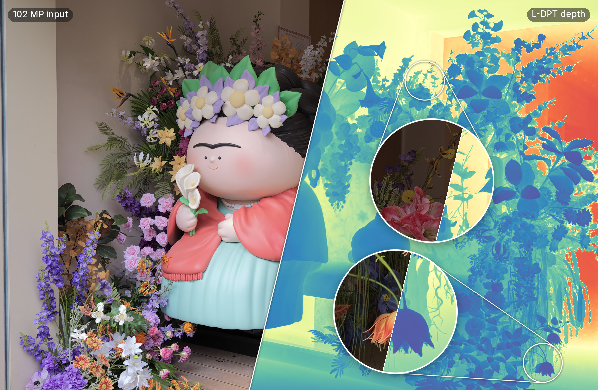
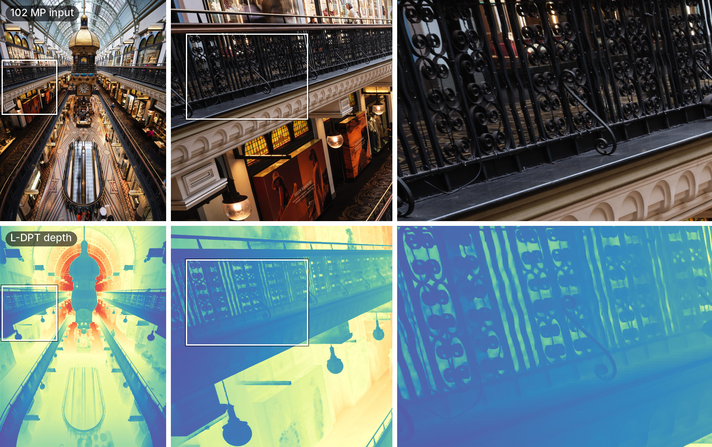
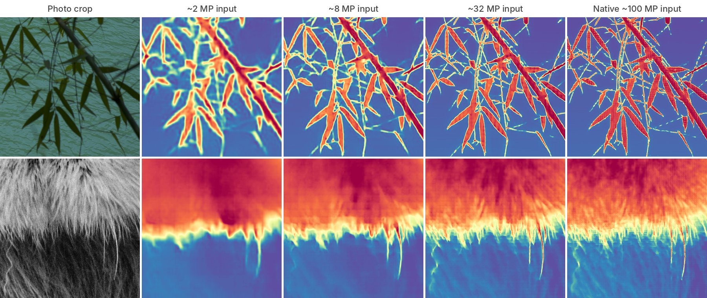
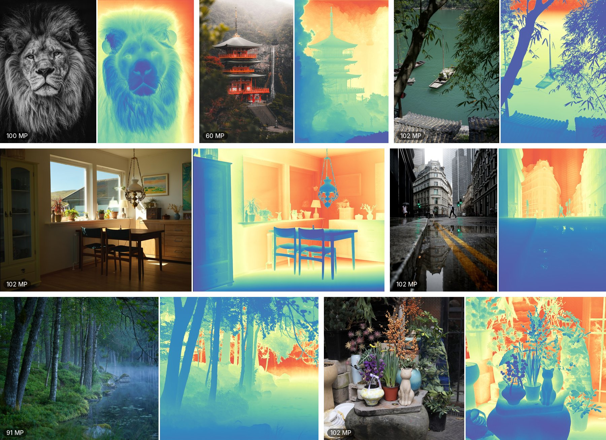

# L-DPT: Scaling Dense Prediction with Latent Decoding

**Train at 768. Run at 100 megapixels.**<br>
European Conference on Computer Vision (**ECCV**) 2026

[ [Project](https://xywu.me/l-dpt) ] [ [Code](https://github.com/Pointcept/L-DPT) ] [ [Demo](https://huggingface.co/spaces/pointcept-bot/L-DPT) ] [ [Weights](https://huggingface.co/pointcept-bot/L-DPT) ] [ [Training data](https://huggingface.co/datasets/pointcept-bot/DepthHybrid) ] [ [Bib](#citation) ]

<p align="center">
  <a href="docs/assets/teaser.jpg"></a>
</p>

*A 102 MP photo (11656 x 8742) and its depth from L-DPT Large (zero-shot), split along a diagonal.
The two magnifiers are crops of the native-resolution output.*

L-DPT predicts relative depth at the native resolution of a photo, up to 100 megapixels.
It pairs a frozen DINOv3 ViT-7B/16 encoder with a 271M-parameter latent DPT decoder that
was trained on 768 x 768 crops only, with no high-resolution training data. At high
resolution the frozen encoder runs in overlapping 3072 px windows and the decoder decodes
the whole latent grid in one pass; below 3072 px it is one forward pass.
The more pixels you give it, the finer the structure it resolves: separate leaves,
single strands of fur, wrought-iron scrollwork.

## Highlights

- *Nov 2026*: code, the weights of both depth models and of the COCO-Stuff
  segmentation model, and the
  [online demo](https://huggingface.co/spaces/pointcept-bot/L-DPT) are released.

## Quick start

You need an NVIDIA GPU and Meta's DINOv3 ViT-7B/16 weights: see
[Requirements](#requirements). The weights take 13.5 GiB of GPU memory; at native
resolution the peak allocation is 15 GiB at 2 MP, 21 GiB at 32 MP and 33 GiB at 100 MP.
```bash
git clone https://github.com/Pointcept/L-DPT.git && cd L-DPT
pip install -e ".[demo]"   # Linux, Python 3.10+; installs PyTorch 2.8+ from PyPI if needed
export LDPT_DINOV3=/path/to/dinov3_vit7b16_pretrain_lvd1689m-a955f4ea.pth  # or the Hugging Face folder
```

```python
import cv2
from ldpt.models.l_dpt import api

model = api.load("l-dpt_large_depth_zeroshot")  # downloads the 1.08 GB weights file once
image = cv2.cvtColor(cv2.imread("photo.jpg"), cv2.COLOR_BGR2RGB)
depth = api.predict(model, image)               # HxW float32, larger = farther; runs at short side 768
depth = api.predict(model, image, size=None)    # at the photo's native resolution
```

```bash
python scripts/demo_depth.py photo.jpg   # photo_depth.png + .npy at native resolution (--size auto: 768)
```

Every option, the output files and the full timing table: [docs/inference.md](docs/inference.md).
On aarch64, install PyTorch first: [docs/install.md](docs/install.md).

## Run the demo locally

The [online demo](https://huggingface.co/spaces/pointcept-bot/L-DPT) runs on your own GPU
too, at each photo's native resolution. With `LDPT_DINOV3` set as above:

```bash
pip install -e ".[demo,app]"
python demo/hf_space/app.py   # loads the model, then serves http://127.0.0.1:7860
```

`--host 0.0.0.0`, `--port` or `--share` for a remote machine, `--examples DIR` for a
gallery of your photos: [docs/inference.md](docs/inference.md#the-demo).

## Requirements

**Before you start.** L-DPT needs Meta's DINOv3 ViT-7B/16 weights, which we cannot
redistribute. Request access from Meta
([release page](https://github.com/facebookresearch/dinov3) or the gated
[Hugging Face repo](https://huggingface.co/facebook/dinov3-vit7b16-pretrain-lvd1689m),
27 GB), then point `LDPT_DINOV3` at the file or at the downloaded folder
([docs/install.md](docs/install.md#dinov3-weights) shows both). The first `api.load`
reads the original file once to check its sha256; later loads skip that.

Native-resolution inference needs a CUDA GPU. Time and peak GPU memory for one photo:

| Photo, native resolution | Peak GPU memory | RTX PRO 6000 Blackwell |
|---|---|---|
| 2 MP | 15 GiB | 0.64 s |
| 8 MP | 19 GiB | 7.6 s |
| 32 MP | 21 GiB | 39 s |
| 60 MP | 24 GiB | 106 s |
| 100 MP | 33 GiB | 205 s |

Zero-shot model, one model loaded and warm, no mirrored pass (`flip=True` runs the
network twice), PyTorch 2.8. From 8 MP up the photos have a side above 3072 px, so the
encoder runs in windows. The RTX PRO 6000 runs the attention order the code picks for
it ([docs/inference.md](docs/inference.md#time-and-memory)). The 100 MP row is a 102 MP
photo. Peak GPU memory is PyTorch's peak allocation; the scripts and the demo set
`PYTORCH_CUDA_ALLOC_CONF=expandable_segments:True`, with which PyTorch reserves 34 GiB
at 100 MP on an RTX PRO 6000 (44 GiB without). Other environments (conda, aarch64),
both ways to get DINOv3 and the tests: [docs/install.md](docs/install.md).

## Models

| Model | Preset and weights file | Training data |
|---|---|---|
| L-DPT Large (zero-shot) | `l-dpt_large_depth_zeroshot` | 8 synthetic and multi-view sets; no image of the benchmarks below |
| L-DPT Large (mixed) | `l-dpt_large_depth_mixed` | the same + the NYUv2, KITTI and DIODE training splits |
| L-DPT Large (COCO-Stuff) | `l-dpt_large_semseg_cocostuff` | COCO-Stuff 164k train (171 classes) |

Use **zero-shot** for photos: it is the model of the demo and of every figure here. Use
**mixed** for the lowest benchmark error: it also trains on the NYUv2, KITTI and DIODE
training splits.

The two depth models share one architecture and differ only in training data: a frozen
DINOv3 ViT-7B/16 encoder and a 271M-parameter latent decoder. They output relative depth:
positive, larger = farther, defined up to a scale and a shift per image. The segmentation
model taps the same frozen encoder with a 772M-parameter latent decoder and labels every
pixel with one of the 171 COCO-Stuff classes (`model.class_names`). Each preset is also
the name of its weights file (`<preset>.pth`: 1.08 GB for depth, 3.09 GB for
segmentation, on [Hugging Face](https://huggingface.co/pointcept-bot/L-DPT)), in the form
`l-dpt_<decoder size>_<task>_<training data>`. `api.load` downloads the file on first use
and checks its sha256; `LDPT_CKPT_LARGE_DEPTH_ZEROSHOT`, `LDPT_CKPT_LARGE_DEPTH_MIXED` or
`LDPT_CKPT_LARGE_SEMSEG_COCOSTUFF` points it at a local copy instead.

## High-resolution inference

<p align="center">
  <a href="docs/assets/zoom.jpg"></a>
</p>

*A 102 MP photo (8742 x 11656) of a shopping arcade and its depth from L-DPT Large (zero-shot),
zoomed in twice: the balcony at 0.19x and its iron railing at 0.5x of the native-resolution output.*

<p align="center">
  <a href="docs/assets/resolution.jpg"></a>
</p>

*The same window of two photos, zero-shot model, input at 2, 8 and 32 MP and at native
resolution (100 MP); each tile uses its own colour range.*

Detail keeps growing with the input resolution, so run at the native resolution:
`api.predict(model, image, size=None)` for one photo, or `scripts/highres_infer.py` for
a folder of photos (16-bit depth, full-resolution colour depth, crops, timings):
[docs/inference.md](docs/inference.md). The scripts and the demo colour depth near blue,
far red, through a tone curve fitted to each photo.

## Examples and demo

<p align="center">
  <a href="docs/assets/gallery.jpg"></a>
</p>

*Seven photos of 60-102 MP and their depth, zero-shot model at native resolution.*

Try your own photo in the [online demo](https://huggingface.co/spaces/pointcept-bot/L-DPT),
or [run it on your own GPU](#run-the-demo-locally).

## Results

AbsRel (%, lower is better) / δ1 (%, higher is better), with Marigold's masks: NYUv2
with the standard Eigen crop, KITTI with the Eigen crop of the benchmark frame, ETH3D
and all 771 DIODE validation images uncropped; a RANSAC scale and shift fitted in depth
per image (seed 0). One set of weights per model for all four sets; the short side
resized to 768; the prediction averaged with that of the mirrored image.

| Model | NYUv2 | KITTI | ETH3D | DIODE |
|---|---|---|---|---|
| L-DPT Large (zero-shot) | 3.42 / 98.28 | 6.43 / 96.97 | 3.64 / 99.17 | 21.47 / 85.74 |
| L-DPT Large (mixed) | 2.87 / 99.09 | 5.96 / 97.61 | 3.47 / 99.10 | 14.43 / 87.64 |

The zero-shot model sees no image of these sets in training (its synthetic data include
Virtual KITTI 2); the mixed model trains on the NYUv2, KITTI and DIODE training splits.
There is no separate validation split: every training epoch was scored on these four
sets, and the released weights (zero-shot: epoch 7; mixed: the average of epoch 4 and
the end of its anneal) were chosen with those scores. Protocol, masks and the command
that reproduces this table: [docs/evaluation.md](docs/evaluation.md).

Semantic segmentation: mIoU (%, higher is better) over the 171 classes of COCO-Stuff
164k val (5,000 images), the short side resized to 768, the whole image; single scale /
averaged with the mirrored image.

| Model | COCO-Stuff |
|---|---|
| L-DPT Large (COCO-Stuff) | 53.87 / 53.99 |

The weights (stage-1 epoch 9 and the average with its anneals) were chosen with the
scores on this val set too. The command that reproduces it:
[docs/training.md](docs/training.md#segmentation).

## Training, evaluation, data and segmentation

- **Training.** The released models are reproduced by `configs/hybrid/*.py` (depth) and
  `configs/cocostuff/*.py` (segmentation) on 8 GPUs
  with 80 GB each: [docs/training.md](docs/training.md). The depth loss is specified in
  [docs/depth_loss.md](docs/depth_loss.md).
- **Evaluation.** The benchmarks above: [docs/evaluation.md](docs/evaluation.md).
- **Data.** Download the processed training sets from
  [DepthHybrid](https://huggingface.co/datasets/pointcept-bot/DepthHybrid), or rebuild
  them: [docs/data.md](docs/data.md).
- **Segmentation.** The same design also does semantic segmentation. The COCO-Stuff
  model is in [Models](#models) and runs through the same API
  ([docs/inference.md](docs/inference.md#segmentation)); the COCO-Stuff and PASCAL VOC
  training configs are in [docs/training.md](docs/training.md#segmentation), the PASCAL
  VOC weights come in a later release.

Contributing: see [AGENTS.md](AGENTS.md).

## Citation

```bibtex
@inproceedings{wu2026latent,
  title     = {Scaling Dense Prediction with Latent Decoding},
  author    = {Wu, Xiaoyang and Lao, Yixing and Wang, Chengyao and Yang, Senqiao and Zhang, Yujia and Zhao, Hengshuang},
  booktitle = {European Conference on Computer Vision (ECCV)},
  year      = {2026}
}
```

## License

The L-DPT code and model weights are released under
[CC BY-NC 4.0](LICENSE) (attribution, non-commercial use). Third-party code keeps its own
licence ([THIRD_PARTY_LICENSES.md](THIRD_PARTY_LICENSES.md)). The DINOv3 encoder is
Meta's, under the DINOv3 License, and is not redistributed here.

## Acknowledgements

L-DPT builds on [DINOv3](https://github.com/facebookresearch/dinov3) (the frozen
encoder), [DPT](https://github.com/isl-org/DPT), [MoGe](https://github.com/microsoft/MoGe)
(the robust alignment behind the depth loss) and the training framework of
[Pointcept](https://github.com/Pointcept/Pointcept).
